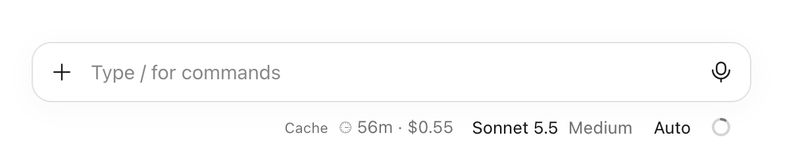
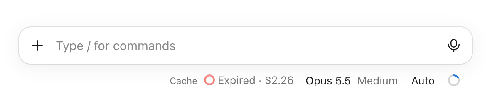

# claude-desktop-cache-and-cost

A status line for the Code tab of Claude Desktop: how long your prompt cache stays warm, and what the session has cost so far.





## Why

While the cache is warm, your next prompt reuses the conversation cheaply. Once it expires, the next prompt pays to send the whole conversation again. The countdown tells you how long you have; the cost tells you what the session has spent.

## Install

In Claude Desktop: click **+** next to the prompt box, then **Plugins**, **Add marketplace** with `jcesarperez/claude-desktop-cache-and-cost`, then **Add plugin**.

Or from a shell:

```
claude plugin install Cache --marketplace jcesarperez/claude-desktop-cache-and-cost
```

The line shows in the Desktop Code tab only.

## How long the cache lasts

The countdown runs from the start of the last request that used the cache, as the API counts it. It reads whether that cache lasts 1 hour or 5 minutes from the session's transcript after each turn, and assumes 1 hour until it has seen one.

## License

MIT
